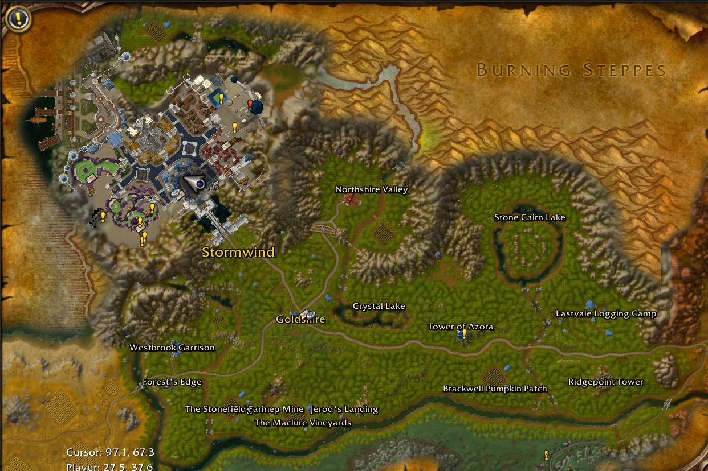
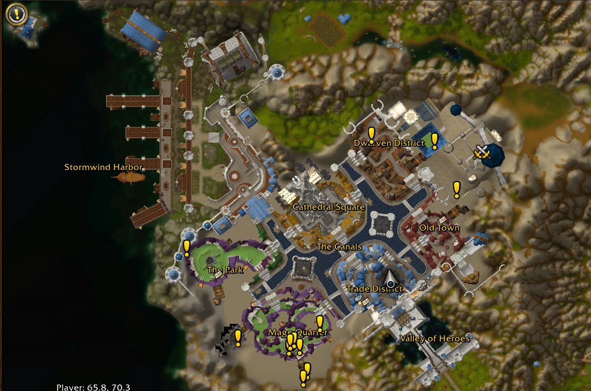
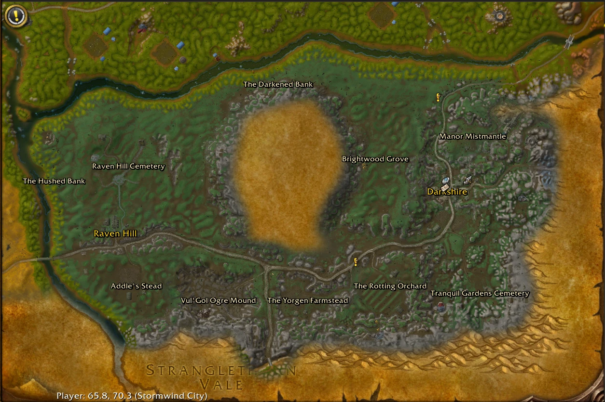

# HD Map Lite

High-resolution world map art for WoW: Forever, with nothing else.



| Stormwind, with its districts | Duskwood: unexplored ground stays stock |
|---|---|
|  |  |

- **World, Kalimdor, Eastern Kingdoms:** the stitched HD tiles from the
  *High Fidelity World Map: Art* pack (`HighFidelityWorldMap_Art_Forever`).
- **53 zone maps** (outdoor zones, the four capitals it covers, and three
  battlegrounds): the client's own minimap tiles, laid out as the zone map
  (the "satellite" view).
- **Fog of war, on every map:** the HD art appears only where you've explored,
  cut to the same torn edges as Blizzard's reveal art. Unexplored ground shows
  the stock map.
  - **Zone maps** reveal the zone itself and the neighbouring zones visible at
    its edges, each by its own exploration.
  - **Continent and world maps** reveal every zone on them the same way.
  - Cities and battlegrounds have no fog in the stock UI either, so their zone
    maps are drawn in full. On the continent they show through their
    surrounding zone's reveal.
- **Area names on zone maps:** towns, capitals, subzones and the districts of
  Stormwind, Orgrimmar, Thunder Bluff and Darnassus, in gold with a black
  outline, since the HD art covers the names painted on the stock map.
  Under fog a name appears once its spot is explored, like the stock map's.
  Names keep a steady size on screen while you zoom (they spread apart rather
  than grow), which keeps the text crisp instead of shimmering.
  Names that would overlap are nudged up or down, the less important one
  moving the shortest way, and settle back onto their spots as you zoom in.
- **Player halo:** a soft dark disc under your arrow so it stands out on the
  busier HD art. It follows you while the map is open.
- **Everything else** (dungeons, caves, Ironforge, Undercity, other
  battlegrounds): Blizzard's stock map, untouched.

No options, SavedVariables, slash commands, keybinds or globals. To turn it
off, disable the addon.

## Install

### From CurseForge (once published)

Install **HD Map Lite**. The CurseForge app also installs the
*High Fidelity World Map: Art* pack, which it lists as a required dependency.

### By hand

1. Put the addon in `World of Warcraft\_forever_\Interface\AddOns\HDMapLite`.
   The folder must be named `HDMapLite` to match `HDMapLite.toc`, or the game
   won't load it. From git:

   ```
   git clone https://github.com/denolfe/hfwm-lite.git HDMapLite
   ```

2. Install the [*High Fidelity World Map: Art*](https://www.curseforge.com/wow/addons/hfwm-art)
   pack. Without it, the world and continent maps stay stock (zone maps still
   work), and the addon says so in chat a few seconds after you log in.
3. Disable or remove **High Fidelity World Map** itself if you have it: the
   two would draw over each other. HD Map Lite needs only the art pack.

The character screen lists the art pack as "missing dependency", because its
TOC requires High Fidelity World Map. That's expected: the pack has no code,
and HD Map Lite reads its tiles by file path.

## Why it shouldn't conflict

It adds its own frames to the map canvas and draws only into them:

- an overlay frame, with one child layer for each of the last three maps drawn;
- in each layer, a small frame for the labels and the halo;
- one more child frame that runs a throttled `OnUpdate` while the map is open.

It never hides, moves, re-levels, hooks or writes a field on anything of
Blizzard's.

| High Fidelity World Map does | HD Map Lite |
|---|---|
| Hides Blizzard's detail layers and tiles; hooks `Show`/`SetShown`/`RefreshDetailTiles` on them and writes `_hfwmHooked` onto them | Covers them with an opaque backdrop instead |
| Hides the map frame's backing textures (`MapFrameBg`) | Not needed |
| Sets exploration pins to alpha 0 and re-levels them every frame from an `OnUpdate` | Puts its frame one level above the exploration pins (a read-only lookup). Its own `OnUpdate`, on its own frame, only moves the player halo and keeps labels screen-sized, and stops when the map closes |
| `hooksecurefunc` on `WorldMapFrame.OnMapChanged`, `ShowUIPanel`, `HideUIPanel`, `ToggleWorldMap`, `ToggleQuestLog`, `MarkCanvasDirty`, pin pools | `EventRegistry` callbacks only, which Blizzard runs isolated |
| `HookScript` on `WorldMapFrame`, `GameMenuFrame` and the scroll container | Scripts on its own frames only (`OnSizeChanged`, `OnUpdate`) |
| `SetBindingClick("ALT-M")`, gamepad override bindings | None |
| `UIDropDownMenu`, `StaticPopup`, Ace3, a settings panel | None |
| Fog of war by reading Blizzard's live exploration-pin textures (after setting them to alpha 0) and anchoring masks to them | Asks `C_MapExplorationInfo` for the explored overlays and builds its own masks from the same files on its own frame |
| Continent/world fog from per-zone outline masks, revealing a zone only once it's fully explored or its achievement is earned; tracks visits in SavedVariables | Projects each zone's explored overlays onto the open map with `C_Map.GetMapRectOnMap`, so continents reveal exactly what you've explored. No extra art, no saved state |
| Area labels with six types, fonts, gradients, fades and custom entries | Towns, capitals, subzones and city districts in one fixed style |
| Caves, zoom levels, map memory, keep-centred, the HD/SD slider, coordinates | Out of scope |

Known interaction: *Spoken Places*' map highlight sits on the same frame level
as the HD art. Whether it draws above or below is up to the client; it's
cosmetic.

## Development

- `luacheck .` lints the addon and the specs (`.luacheckrc`).
- `busted tests/map_spec.lua` runs the specs. They drive the addon against a
  fake world map and need no game client.
- [TESTING.md](TESTING.md) is the in-game test plan, which covers what the
  specs can't: taint, the real art, alignment and how it looks.

Releases are packaged with the BigWigs packager (`.pkgmeta`), which also sets
the art pack as a required dependency on CurseForge.

## Credits

The zone tile layout table, the list of fogged zones (`Zones.lua`) and the
area label positions (`Labels.lua`, generated from the game's own tables) come
from [High Fidelity World Map](https://github.com/Sectimus/HighFidelityWorldMap)
by Sectimus. Its CurseForge page lists it as MIT; the repository has no
LICENSE file. The HD art is the separate *High Fidelity World Map: Art* pack
(All Rights Reserved), which this addon does not include. Users install it
themselves.
